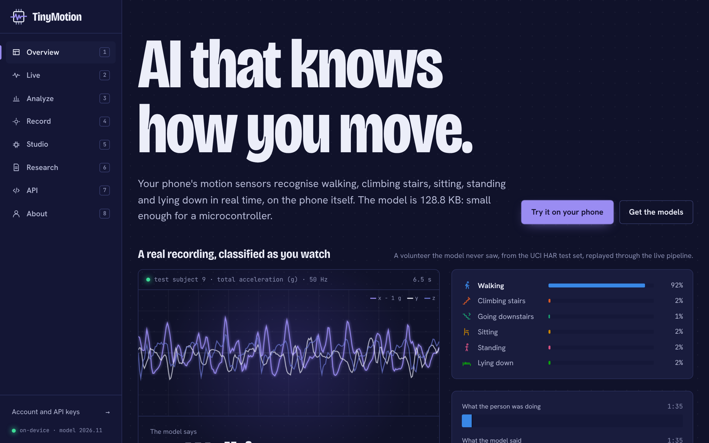
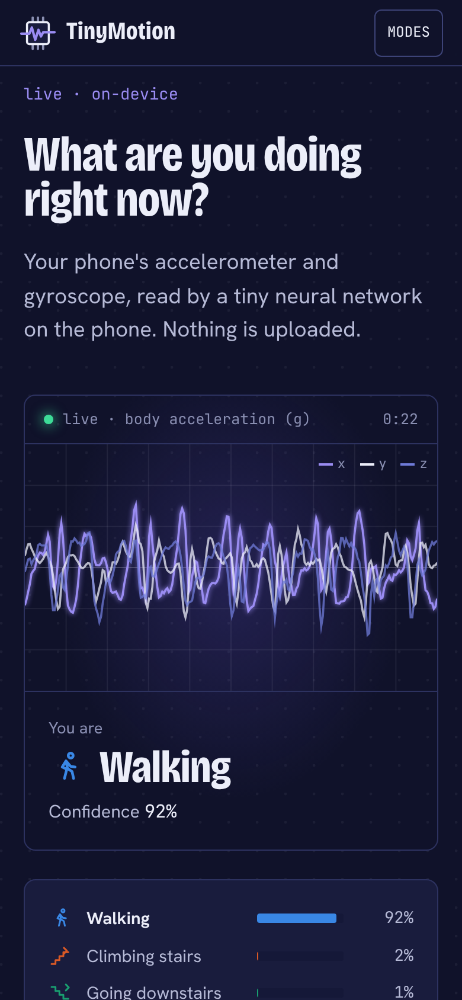

<p align="center">
  
</p>

<h1 align="center">TinyMotion</h1>

<p align="center">
  <b>AI that knows how you move.</b><br />
  Human activity recognition from a phone's motion sensors, running in the browser, with models small enough for a microcontroller.
</p>

<p align="center">
  <a href="https://tinymotion.vercel.app"><b>tinymotion.vercel.app</b></a>
  &nbsp;|&nbsp; <a href="https://tinymotion.vercel.app/live">Live</a>
  &nbsp;|&nbsp; <a href="https://tinymotion.vercel.app/studio">Model studio</a>
  &nbsp;|&nbsp; <a href="https://tinymotion.vercel.app/research">Research</a>
  &nbsp;|&nbsp; <a href="https://tinymotion.vercel.app/developers">API</a>
</p>

<p align="center">
  <a href="https://github.com/agarwalpranay02/tinymotion/actions/workflows/ci.yml"></a>
</p>

<p align="center">
  
  
</p>

## What it does

TinyMotion classifies six everyday activities (walking, walking upstairs, walking downstairs, sitting, standing, lying down) from 2.56-second windows of accelerometer and gyroscope data.

- **Live.** Open the site on a phone, hold it or pocket it, and see the activity update twice a second. Sensor data never leaves the device: the network runs in plain TypeScript in the page.
- **Analyze.** Drop in a CSV from any phone or wearable logger. Columns and units are detected, the signal is resampled and filtered the same way as the training data, and you get a timeline.
- **Record.** Capture your own labelled sessions and download them as CSV.
- **Model studio.** Download each model as Keras, TFLite fp32, full-INT8 TFLite, a TFLite Micro C array, or a dependency-free C99 header. Benchmark the network in your browser.
- **API.** `POST /api/v1/classify` with one window or up to 64. You get free keys after signing in with Google.

It's a progressive web app, so it installs to the home screen and the Live mode works offline.

## Results

All numbers are on the official UCI HAR test set: 9 people the models never saw, 2,947 windows. Model selection used only the training subjects. Four of them (1, 7, 22, 30) were held out to pick the epoch, then the model was retrained on all 21 and tested once.

| Model | Parameters | Shipped model | Across seeds | Phone rotated (seed mean) | INT8 size · accuracy |
|---|---:|---:|---:|---:|---:|
| TinyMotion Anywhere | 35,558 | 93.08% | 93.4 ± 1.1% (5 seeds) | 92.8 ± 1.2% | 85.7 KB · 93.5% |
| TinyMotion Study | 35,558 | 95.18% | 93.3 ± 1.2% (5 seeds) | 77.6 ± 1.1% | 85.7 KB · 94.6% |
| Paper MobileNet1D | 12,870 | 92.67% | 92.1 ± 0.7% (5 seeds) | 80.3 ± 0.7% | 31.7 KB · 92.7% |

"Phone rotated" applies a random rotation about gravity to every test window, which is what happens when the phone sits in a pocket at a different angle. The Anywhere model is trained for that and is the default on the site.

The live pipeline was checked separately: running the test set through the in-browser resampler and gravity filter, instead of the dataset's own preprocessing, gives 92.81% against 93.08%.

For reference, the paper's own training script under the same evaluation reaches 91.65% (MobileNet1D, 12,870 parameters) and 92.33% (baseline CNN, 257,254 parameters).

Every export is checked on the full test set. The TypeScript engine, the C header (compiled with `gcc -Wall -Wextra -Werror`) and the fp32 TFLite file give the same accuracy as Keras. The INT8 file is quantised, so its accuracy differs slightly and is listed in the table.

## Architecture

```
apps/web     Next.js 16 app (App Router), React 19, Tailwind 4
  src/lib/engine   inference engine and live signal pipeline (TypeScript, no WASM)
  src/app/api/v1   classify and health endpoints
  public/models    exported models, one folder per model
ml           training, export and verification scripts (TensorFlow, NumPy, SciPy)
```

The network is a small residual 1D CNN built from depthwise-separable convolutions. Batch norm is folded into the convolutions at export, and the result is written as a short op program (`model.json` and `weights.bin`). The browser engine, the API and the generated C header all run that same program.

Security and operations:
- strict nonce-based CSP, HSTS, and a Permissions-Policy limited to the motion sensors
- hashed API keys with per-key rate limits and monthly quotas
- request validation with zod
- Dependabot, CodeQL and dependency audits
- CI runs type-checking, lint, unit tests, a production build, Playwright tests on desktop and phone, and the C parity check

## Run it locally

```bash
cd apps/web
cp .env.example .env.local
npm install
npm run dev
```

With no `DATABASE_URL`, the app uses an embedded Postgres (PGlite) under `.data/`. Motion sensors need HTTPS on a real phone, so for Live testing use a tunnel or the deployed site.

To retrain:

```bash
cd ml
pip install -r requirements.txt
python prepare_data.py "UCI HAR Dataset"   # packs the unzipped UCI HAR download
python train.py --cfg tinymotion_anywhere --epochs 40
python finalize.py                         # exports every model into apps/web/public/models
python check_c.py                          # compiles the C headers and compares with Keras
```

Free hosting (Vercel Hobby and Neon) is described in [FREE_HOSTING.md](FREE_HOSTING.md).

## Research

Based on *TinyML-Based Lightweight Deep Learning Model for Human Activity Recognition on Edge Devices*, presented at WCAIAA 2026 (NFSU Goa) and to appear in Springer Lecture Notes in Networks and Systems.

## Data and licences

- Training data: Human Activity Recognition Using Smartphones, Reyes-Ortiz, Anguita, Ghio, Oneto and Parra, UCI Machine Learning Repository, [doi:10.24432/C54S4K](https://doi.org/10.24432/C54S4K), CC BY 4.0. The dataset is not included in this repository.
- Code and models: see [LICENSE](LICENSE). The models may be used for personal, educational and research work. For commercial use, write to tinymotion.app@gmail.com.
- Third-party components: see [NOTICE](NOTICE).

Built by [Pranay Agarwal](https://github.com/agarwalpranay02).
